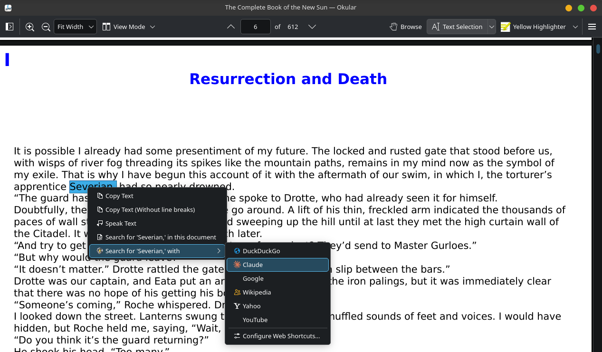
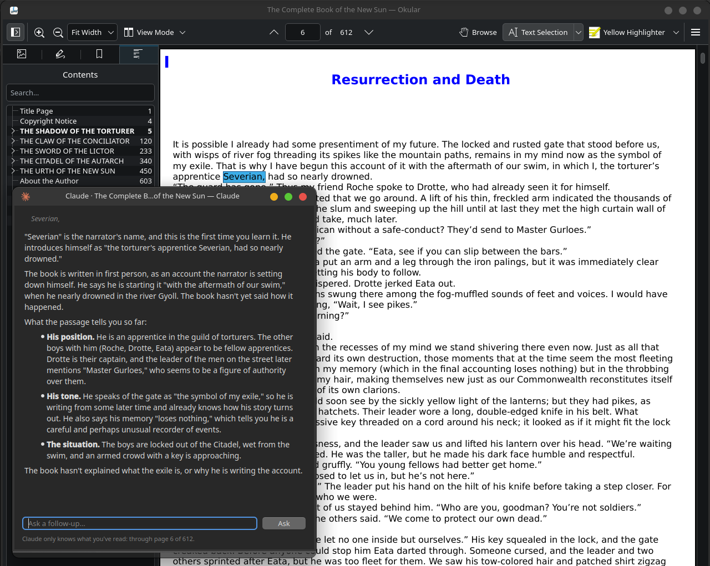

> **Notice:** I threw this together with the lowest possible effort with Claude on Fedora and I will probably not maintain this repo.

# clokular

Highlight text in Okular, right-click, and Claude explains it. It only uses
what you've read so far, so it won't spoil anything.

```
right-click selected text → Search for '…' with → Claude
```

A small window opens beside Okular with the explanation, plus a box for
follow-up questions. It runs your installed `claude` command (Claude Code), so
it uses your Claude subscription and needs no API key.

Works with EPUB and PDF, in the Flathub Okular or a system Okular.





## Install

### 1. Get the requirements

| Requirement | What it's for | How to get it |
|---|---|---|
| Okular | the reader | `flatpak install flathub org.kde.okular` (or your distro's package) |
| Claude Code, signed in | answers, on your Claude subscription | `curl -fsSL https://claude.ai/install.sh \| bash`, then run `claude` once and sign in with your Claude account |
| Python 3.10+ with PySide6 | the answer window and EPUB layout | Fedora: `sudo dnf install python3-pyside6`. Atomic desktops (Aurora, Kinoite, Bazzite): usually preinstalled, otherwise `pip install --user PySide6` |
| poppler-utils | reading PDFs (`pdftotext`) | Fedora: `sudo dnf install poppler-utils` (preinstalled on most KDE desktops) |
| `busctl`, `xdg-mime` | finding your page, registering the link handler | come with systemd and xdg-utils |

On Aurora with Claude Code installed, everything is already there.

### 2. Run the installer

```sh
cd ~/repos/clokular        # wherever you keep this folder
./install.sh
```

The installer checks every requirement first. If something is missing, it
tells you how to fix it and changes nothing. To run only the check:
`./install.sh --check`.

### 3. Restart Okular

Quit Okular completely and open it again. Then select some text, right-click,
and choose **Search for '…' with → Claude**.

### Uninstall

```sh
./uninstall.sh            # removes the menu entry, link handler and icon
./uninstall.sh --purge    # also deletes cached book text, past sessions and settings
```

If you move this folder, run `./install.sh` again so the link handler points
to the new location.

### What the installer changes

The installer runs `bin/clokular install`, which does three things:

1. Registers `bin/clokular` as the handler for `clokular:` links
   (`~/.local/share/applications/clokular.desktop`). The handler names the
   exact Python that passed the check, so another `python3` earlier on your
   PATH (Homebrew, pyenv) can't break it. It also installs the Claude
   icon (`icons/clokular-claude.svg`) into `~/.local/share/icons/hicolor` and
   the Flatpak's `data/icons/hicolor`.
2. Adds a web shortcut called **Claude** to Okular's search providers
   (`~/.var/app/org.kde.okular/data/kf6/searchproviders/claude.desktop` for
   the Flatpak).
3. Adds `claude` to the preferred shortcuts list in Okular's
   `kuriikwsfilterrc`. Your existing preferred shortcuts are kept.

`./uninstall.sh` (or `clokular uninstall`) reverses all of this, putting
`kuriikwsfilterrc` back the way it was. `clokular status` shows what's
installed and which book and page Okular reports.

## How it works

Okular has no add-on system for menus (its plugins only read file formats).
But its text-selection menu does list your *web search shortcuts*, and a
shortcut can point to any URL. clokular's shortcut points to
`clokular:<selected text>`. Okular opens that link through the desktop
portal, and the portal launches `bin/clokular` on the host.

Then clokular:

1. **Asks Okular where you are.** It reads the document path and current page
   over D-Bus (`org.kde.okular.Instance_*`, `/okular`, `/okular2`, … one per
   tab).
2. **Extracts the book's text.**
   - **PDF:** `pdftotext` gives exact page boundaries.
   - **EPUB:** Okular lays EPUBs out itself, as 600×800 pages in a
     QTextDocument with each chapter starting on a new page, so EPUB page
     numbers don't exist in the file. clokular repeats those layout steps with
     PySide6 to get page boundaries close to Okular's. The result is cached in
     `~/.cache/clokular/books/`.
3. **Finds your place.** It looks for the highlighted text on and around the
   page Okular reports. Page counts can differ (Okular's depend on its font
   settings), so the page number is scaled to clokular's layout before
   searching. If the passage appears more than once, it picks the occurrence
   nearest your page, preferring earlier ones.
4. **Writes out what you've read.** That's everything up to the end of the
   page holding your selection, saved to `read-so-far.txt` in a fresh session
   folder under `~/.cache/clokular/sessions/`. Session folders are deleted
   after 14 days.
5. **Runs Claude, locked down:**
   `claude -p --restricted --tools Read,Grep --strict-mcp-config --disable-slash-commands`,
   with the session folder as its working directory. Claude can only read and
   search that one file. `--restricted` also keeps your own Claude Code hooks,
   plugins and settings out of these sessions. The excerpt around your page
   goes in the message, and Claude Greps `read-so-far.txt` for earlier
   mentions of names and terms.

### Spoiler protection

- Claude never receives text past your page. This is enforced in code
  (`clokular/locate.py`) and tested (`tests/`).
- The prompt (`clokular/prompt.py`) also tells Claude to ignore what it
  already knows about the book and its sequels. It must not hint at
  significance, and it should say "the book hasn't explained this yet"
  instead of guessing. For names the book hasn't introduced yet, it reveals
  nothing, not even gender.
- Claude may still recognize a famous book. The instructions make leaks very
  unlikely, but they can't make them impossible. If you notice one, the
  session folder and `~/.cache/clokular/clokular.log` show what was sent.

If clokular can't find the highlighted text, Claude gets the pages before
your current one. If the text only appears earlier in the book than your
page, Claude gets text up to that earlier point: it may know less than you
do, but never more. The window footer says which case applied.

## Settings

Optional, in `~/.config/clokular/config.json`:

```json
{
  "model": "sonnet",
  "claude_path": "",
  "epub_font": "Sans Serif",
  "epub_font_size": 9
}
```

- `model`: any `claude --model` value (`sonnet`, `opus`, `haiku`, or a full
  model ID).
- `epub_font` and `epub_font_size`: the font used to reproduce Okular's EPUB
  pages. The defaults match the Flathub Okular. Changing them invalidates the
  book cache.

## Limitations

- The entry sits one level down, under **Search for '…' with**. Okular hides
  that submenu for copy-protected (DRM) documents.
- With several Okular tabs open, clokular picks the open document that
  contains the highlighted text.
- On Wayland, KWin decides whether a new window gets focus. If the answer
  window opens behind Okular, check KWin's focus-stealing prevention setting.

## Testing

```sh
python3 -m unittest discover -s tests -t .   # offline, about 5 s
python3 -I scripts/spoiler_check.py          # live: asks Claude leading questions
```

`tests/test_real_book.py` runs against a real EPUB if one is present (set
`CLOKULAR_TEST_EPUB` and `CLOKULAR_TEST_EPUB_PAGES`). `spoiler_check.py`
opens a session early in *The Book of the New Sun* and asks about later
characters and events. It flags any answer that mentions a name that isn't
in the text read so far.

### Testing the real menu

To test without touching the Okular you're reading in, run a hidden second
Okular that draws to a VNC framebuffer, with throwaway settings:

```sh
T=~/.cache/clokular/okular-test; mkdir -p $T/config $T/data/kf6/searchproviders
cp ~/.var/app/org.kde.okular/config/kuriikwsfilterrc $T/config/
cp ~/.var/app/org.kde.okular/data/kf6/searchproviders/claude.desktop $T/data/kf6/searchproviders/
printf '[PageView]\nMouseMode=TextSelect\n' > $T/config/okularpartrc
flatpak run --env=QT_QPA_PLATFORM=vnc:size=1280x900:port=5977 \
  --env=XDG_CONFIG_HOME=$T/config --env=XDG_DATA_HOME=$T/data \
  org.kde.okular --page 6 /path/to/book.epub
```

Then drive it with `scripts/vnc.py`: `drag` to select text, `click(...,
button=3)` to right-click, `snapshot` to see the result. Hovering the search
submenu shows **Claude**, and clicking it opens the answer window.

## License

clokular is free software under the [GNU General Public License v3.0 or
later](LICENSE). `clokular/epub.py` follows the page layout of Okular's EPUB
backend (`generators/epub/converter.cpp`, GPL-2.0-or-later).

## Credits

The Claude logo path in `icons/clokular-claude.svg` comes from
[Simple Icons](https://simpleicons.org) (CC0). Claude is a trademark of
Anthropic.
